# 01: Project Build Flow & Architecture Progression

## Visual Build Flow

```mermaid
flowchart TD
    subgraph PhaseA["Phase A: Input Quality & RAG Baseline"]
        E01["Exp 01: PDF Extraction Quality\n(341 pages, Vocab F1 82%, Term 91.8%)"] --> E02["Exp 02: Retrieval Optimization\n(Candidate K=15, Final K=7, Hybrid RRF)"]
        E02 --> E03["Exp 03: Baseline RAG Generation Benchmark\n(Production K=7: Mean Sim 0.824, 66% High Sim)"]
    end

    subgraph PhaseB["Phase B: Controlled Verification"]
        E03 -.->|"Need Automated Verification"| E04["Exp 04: Verification Pilot v1\n(Similarity Fails, DeBERTa 95.6%)"]
        E04 --> E05["Exp 05: Pilot v2 Calibration\n(Thresholds: P(E)>=0.70, P(C)>=0.50)"]
        E05 --> E06["Exp 06: 280-Triple Benchmark\n(DeBERTa Acc 96.43%, Macro F1 0.963)"]
    end

    subgraph PhaseC["Phase C: Claim-Level Verification Crisis"]
        E06 -.->|"Deploy on Live RAG"| E07["Exp 07: Sentence Claims on Q1-Q5\n(15/15 NEUTRAL: 100% Failure!\nPremise Dilution + 57% Truncation)"]
        E07 --> E08["Exp 08: Atomic Claim Decomposition\n(40/44 NEUTRAL: 90.9% Failure!\nContext Loss + High API Latency)"]
        E08 --> E09["Exp 09: Latency Diagnostic Q41\n(84.98s Total Latency / 50 NLI Passes)"]
        E09 --> E10["Exp 10: Evidence Granularity Micro-Units\n(Neutral 80.5%, 18 Context Regressions)"]
    end

    subgraph PhaseD["Phase D: ModernCE & Complete-Answer Breakthrough"]
        E10 -.->|"Paradigm Shift: ModernBERT & Concatenation"| E11["Exp 11: NLI Model Comparison\n(ModernCE 2,048 ctx: 0% Truncation,\n38 Neu -> Ent recoveries)"]
        E11 --> E12["Exp 12: Complete-Answer Multi-Chunk Q1-Q5\n(Q1 jumps 0.348 -> 0.914 Entailed!\nForward passes cut from 50+ to 1-3)"]
        E12 --> E13["Exp 13: 50Q Complete-Answer Benchmark\n(45/48 Content Answers Entailed = 93.75%\nMean Latency 8.33s on CPU)"]
        E13 --> E14["Exp 14: Production Parity Validation\n(100% Parity, 14 passes saved via Abstention)"]
        E14 --> E15["Exp 15: Progressive Telemetry\n(Capped at TOP_3: 0 gains at TOP_4)"]
        E15 --> E16["Exp 16: Grounding Stability\n(3/3 Entailed Deterministic, sigma=0.037)"]
        E16 --> E17["Exp 17: UI & Annotation Readiness\n(4/4 UI Tests Pass, Human Labels Pending)"]
    end

    style PhaseA fill:#e8f4f8,stroke:#2b5c8f,stroke-width:1.5px
    style PhaseB fill:#eafaf1,stroke:#27ae60,stroke-width:1.5px
    style PhaseC fill:#fdedec,stroke:#c0392b,stroke-width:1.5px
    style PhaseD fill:#fcf3cf,stroke:#f39c12,stroke-width:1.5px
```

## Chronological Narrative of the Build Flow

### Phase A: Establishing High-Fidelity Input and Retrieval
- **Step 1 (Exp 01)**: Verified PDF layout parsing. Without clean, uncorrupted ingestion of domain terms (91.8% preservation), downstream retrieval would fail silently.
- **Step 2 (Exp 02)**: Optimized candidate retrieval ($K_{cand}=15$) and final prompt context ($K=7$). Proved that combining lexical matching (`BM25`) with dense embeddings (`BGE-Large`) via Reciprocal Rank Fusion ($k=60$) yields a +8.7% MRR improvement over dense vectors alone and packs 19,322 characters safely within the 20,000-character prompt budget.
- **Step 3 (Exp 03)**: Validated the baseline RAG generation pipeline with $K=7$ across the 50-question benchmark against human reference answers, establishing production metrics (0.824 mean similarity, 66% high-similarity rate, 1.98s average latency) and confirming `TOP_K = 7` for the production pipeline.

### Phase B: Validating NLI Cross-Encoders on Isolated Evidence
- **Step 4 (Exp 04)**: Evaluated whether simple embedding similarity could serve as a hallucination detector. Cosine similarity failed completely: the mean similarity for entailed claims (0.82) was indistinguishable from contradicted claims (0.77). An NLI cross-encoder (`DeBERTa-v3-base`) was introduced, achieving 95.56% accuracy.
- **Step 5 (Exp 05)**: Calibrated decision boundaries ($P(E) \ge 0.70, P(C) \ge 0.50$), achieving 95.0% accuracy on 60 pairs.
- **Step 6 (Exp 06)**: Scaled to a comprehensive benchmark of 280 curated claim-evidence triples. DeBERTa achieved **96.43% accuracy** and a **0.963 Macro F1**, outperforming the best similarity baseline by +35.0%.

### Phase C: The Live RAG Verification Crisis
- **Step 7 (Exp 07)**: Deployed DeBERTa on live RAG outputs from Questions 1 to 5. Generated answers were split into 15 sentences and evaluated against 400-word retrieved chunks. **The verifier collapsed: 15/15 sentences were classified as NEUTRAL (100% false neutral rate)**. Investigation revealed two fatal flaws:
  1. *Premise Dilution*: Matching a 15-word claim against a 400-word chunk diffused cross-attention across irrelevant background text.
  2. *Token Truncation*: 57.3% of pairs exceeded DeBERTa's 512-token limit.
- **Step 8 (Exp 08)**: Decomposed sentences into 44 minimal atomic claims via LLM prompting. The Neutral crisis persisted (**90.9% Neutral**). Stripping grammatical qualifiers destroyed reference context and caused false contradictions.
- **Step 9 (Exp 09)**: Instrumented end-to-end latency on Query 41 (10 atomic claims $\times$ 5 chunks = 50 NLI passes). Total latency reached **84.98 seconds** (57.88s in verification), proving claim-level decomposition operationally unviable for interactive RAG.
- **Step 10 (Exp 10)**: Attempted to shrink evidence by splitting chunks into 3-sentence micro-units. The Neutral rate remained 80.5%, while 18 context-loss regressions occurred where supporting facts were split across boundaries.

### Phase D: Architectural Paradigm Shift & Final Production System
- **Step 11 (Exp 11)**: Upgraded to `dleemiller/ModernCE-base-nli` (ModernBERT, 2,048 tokens). Token truncation dropped to **0.0%**, and 38 pairs immediately shifted from Neutral to Entailed due to full context visibility.
- **Step 12 (Exp 12)**: Executed the core paradigm shift: verifying the **complete answer** against **concatenated top retrieved chunks** (Top-1 + Top-2). Synergistic multi-chunk context resolved premise dilution (Query 1 jumped from $P(E)=0.348$ to $0.914$), and forward passes collapsed from 50+ to 1–2 per query (~1.0s/eval).
- **Step 13 (Exp 13)**: Executed the definitive 50-question benchmark. Across 48 substantive content answers, the verifier achieved **93.75% Entailment (45 / 48)** with 0 contradictions and an average latency of 8.33s on CPU.
- **Step 14 (Exp 14)**: Integrated verification into `verification_1/verifier.py`, achieving 100% status agreement (50/50) and saving 14 forward passes via an automated regex abstention filter.
- **Step 15 (Exp 15)**: Profiled progressive stopping telemetry, discovering that TOP_4 yielded zero additional recoveries and capping progressive verification at TOP_3 in production.
- **Step 16 (Exp 16)**: Confirmed deterministic verifier inference across repeated runs ($\sigma = 0.037$, 3/3 Entailed).
- **Step 17 (Exp 17)**: Surfaced verification trust badges in the Streamlit UI (4/4 UI tests passing) and prepared the 50-question manual annotation framework for future human expert evaluation.
