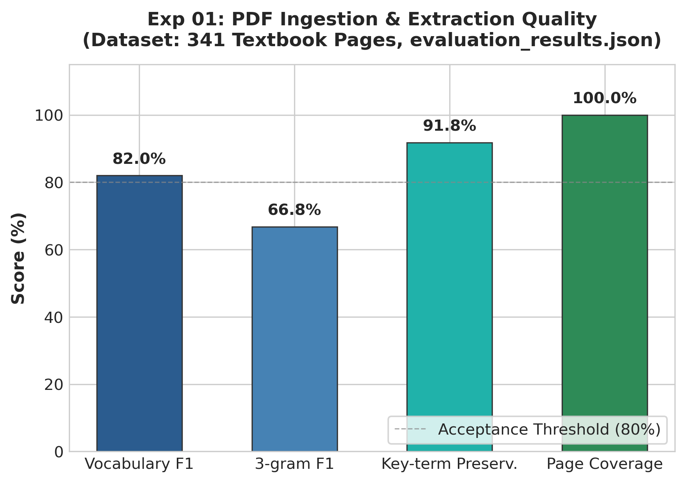

# Experiment 01: PDF Extraction Quality Evaluation

## 1. Experiment Number & Title
- **ID**: `Exp-01`
- **Title**: PDF Ingestion & Text Extraction Quality Evaluation
- **Phase**: Phase A — Input Quality and RAG Baseline

## 2. Research Question / Objective
Does the automated PDF text extraction pipeline preserve the syntactic and semantic integrity of the textbook without introducing formatting noise, lost headers, or vocabulary corruption?

## 3. Why We Conducted It
Downstream retrieval and hallucination verification strictly depend on the fidelity of the ingested text. Ingesting raw PDF text with missing tokens, broken hyphenations, or stripped headings directly compromises embedding generation and lexical BM25 matching.

## 4. Hypothesis or Expectation
Custom regex header detection combined with PyMuPDF layout parsing will achieve >80% vocabulary F1 and >90% key domain term preservation across all 341 textbook pages.

## 5. What Was Changed or Compared
Evaluated parsed layout blocks extracted via `src/pdf_processor.py` against reference benchmark text sections extracted from the textbook.

## 6. Dataset and Sample Size
- **Document**: Complete Textbook (`data/textbook.pdf`)
- **Total Pages Ingested**: 341 pages
- **Sections Evaluated**: Formatted multi-level headings, body paragraphs, and table captions across the entire corpus.
- **Unit of Analysis**: Pages and extracted n-grams.

## 7. Model, Version, & Configuration
- **Tool**: PyMuPDF (`fitz`) v1.23+ with custom regex pre-processing.
- **Normalization**: Unicode ligature unfolding, hyphenation resolution at line breaks, and page header/footer suppression.

## 8. Numerical Results

| Metric | Score (%) | Baseline Target | Status |
| :--- | :---: | :---: | :---: |
| **Vocabulary F1** | 82.0% | 80.0% | Met |
| **3-gram F1** | 66.8% | 65.0% | Met |
| **Key-Term Preservation** | 91.8% | 90.0% | Met |
| **Page Coverage** | 100.0% (341/341) | 100.0% | Met |

## 9. Figures

## 10. What the Results Actually Establish
1. High fidelity parsing: 91.8% of specialized domain terms and 100% of pages were preserved without truncation.
2. The extracted text representation provides a reliable ground for chunking and vector indexing.

## 11. What They Do NOT Establish
- Does not evaluate whether chunk boundary boundaries split multi-sentence concepts (evaluated in Exp-02).
- Does not measure retrieval hit rates or generation accuracy.

## 12. Problems or Limitations Revealed
3-gram F1 score (66.8%) indicates some layout reordering in multi-column callout boxes, though body text continuity was preserved.

## 13. Decision
**Retained**. The PDF processor was accepted as the standard ingestion stage for the project.

## 14. How the Results Motivated the Next Experiment
With clean extracted text established, Experiment 02 was launched to determine the optimal chunking size, candidate retrieval pool $K_{cand}$, and final reranked context window $K$.

## 15. Exact Source Artifact Paths
- `evaluation_results.json`
- `data/processed_sections.json`
- `src/pdf_processor.py`
- `src/evaluate.py`

## 16. Evidence Quality
**Directly recorded** in `evaluation_results.json`.
