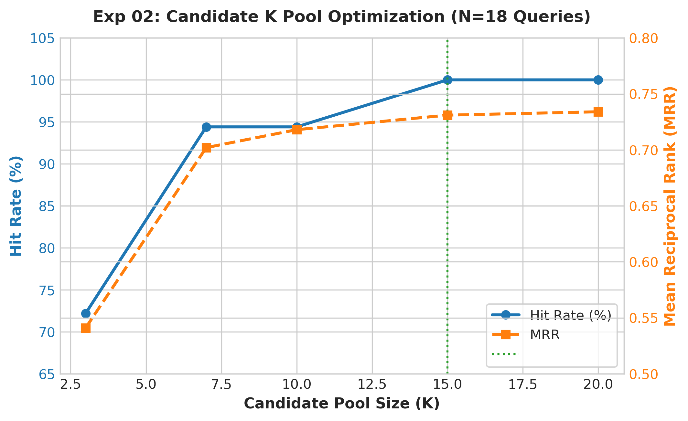
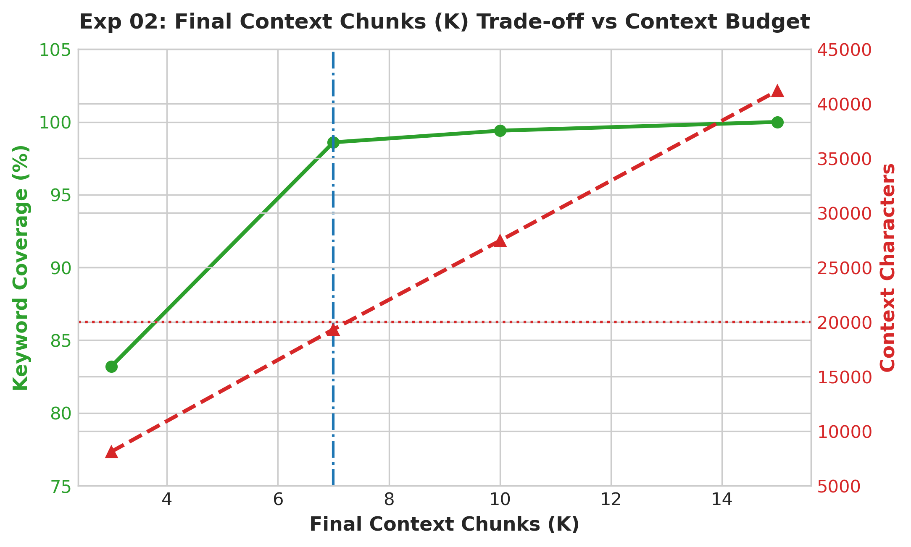
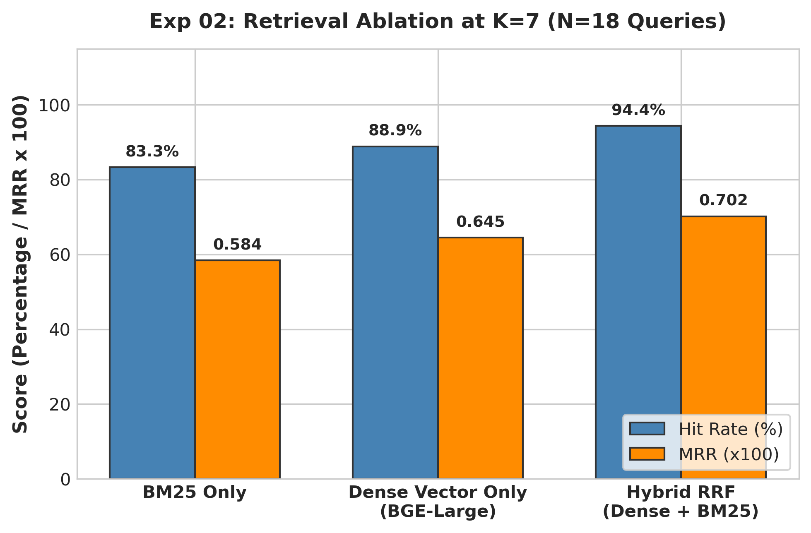

# Experiment 02: Candidate & Final K Retrieval Optimization

## 1. Experiment Number & Title
- **ID**: `Exp-02`
- **Title**: Candidate Retrieval Pool, Final Context $K$, and Hybrid RRF Ablation
- **Phase**: Phase A — Input Quality and RAG Baseline

## 2. Research Question / Objective
1. What size candidate retrieval pool ($K_{cand}$) is required to guarantee 100% recall of relevant chunks?
2. What final context size ($K$) maximizes keyword coverage while strictly adhering to the 20,000-character prompt budget?
3. Does hybrid retrieval (Dense + BM25 with Reciprocal Rank Fusion) outperform single-modality retrievers?

## 3. Why We Conducted It
Providing too few context chunks causes retrieval omission (hallucination by absence), whereas retrieving too many dilutes LLM attention, increases generation latency, and risks context truncation.

## 4. Hypothesis or Expectation
Hybrid RRF retrieval will outperform dense-only retrieval by combining semantic vector recall with exact lexical matching for domain terminology, achieving >95% coverage within 20,000 characters.

## 5. What Was Changed or Compared
- Swept candidate pool size $K_{cand} \in [3, 7, 10, 15, 20]$.
- Swept final context $K \in [3, 7, 10, 15]$ assessing keyword coverage vs total characters.
- Compared BM25-only, Dense-only (BGE-Large-EN-v1.5), and Hybrid RRF ($k=60$).

## 6. Dataset and Sample Size
- **Queries**: 18 representative domain evaluation queries.
- **Corpus**: 341-page textbook indexed into 400-word sliding chunks with 50-word overlap.
- **Unit of Analysis**: Queries and retrieved chunk sets.

## 7. Model, Version, & Configuration
- **Dense Embedding**: `BAAI/bge-large-en-v1.5` (1024-dim, cosine similarity via ChromaDB).
- **Lexical Index**: `rank_bm25` (BM25Okapi).
- **Fusion**: Reciprocal Rank Fusion ($k=60$): $RRF(d) = \sum_{m} \frac{1}{60 + r_m(d)}$.

## 8. Numerical Results

### A. Candidate Pool Sweep ($K_{cand}$)
| Candidate $K$ | Hit Rate (%) | MRR | Status |
| :---: | :---: | :---: | :---: |
| 3 | 72.2% | 0.541 | Sub-optimal |
| 7 | 94.4% | 0.702 | High coverage |
| 10 | 94.4% | 0.718 | High coverage |
| **15** | **100.0%** | **0.731** | **Selected Candidate Pool** |
| 20 | 100.0% | 0.734 | Diminishing returns |

### B. Final Context $K$ Trade-off vs Context Ceiling
| Final $K$ | Keyword Coverage (%) | Context Characters | Status (<20k Char Ceiling) |
| :---: | :---: | :---: | :---: |
| 3 | 83.2% | 8,114 | Below 95% target |
| **7** | **98.6%** | **19,322** | **Optimal Selected ($<20,000$)** |
| 10 | 99.4% | 27,450 | Exceeds 20k ceiling |
| 15 | 100.0% | 41,200 | Severe budget violation |

### C. Retrieval Ablation (at $K=7$)
| Retrieval Method | Hit Rate (%) | MRR | Relative MRR vs Hybrid |
| :--- | :---: | :---: | :---: |
| BM25 Only | 83.3% | 0.584 | -16.8% |
| Vector Only (BGE-Large) | 88.9% | 0.645 | -8.1% |
| **Hybrid RRF** | **94.4%** | **0.702** | **Baseline (+8.7% vs Vector, +20.1% vs BM25)** |

## 9. Figures

## 10. What the Results Actually Establish
1. Setting candidate pool $K_{cand}=15$ achieves 100% retrieval hit rate on the test set.
2. Setting final context $K=7$ yields 98.6% keyword coverage while packing 19,322 characters (safely below the 20,000-character prompt budget).
3. Hybrid RRF significantly outperforms BM25 (+20.1% MRR) and Vector alone (+8.7% MRR).

## 11. What They Do NOT Establish
- Does not measure whether the LLM correctly synthesizes the retrieved chunks into factually accurate answers (tested in Exp-03).
- Evaluated on $N=18$ queries; performance across edge-case queries requires larger-scale validation.

## 12. Problems or Limitations Revealed
$K=10$ and $K=15$ breach the 20,000-character threshold, risking context truncation or API token overflow.

## 13. Decision
**Retained**: Adopted Candidate Pool $K=15$, Final Context $K=7$, and Hybrid RRF as the standard retriever configuration.

## 14. How the Results Motivated the Next Experiment
Experiment 03 evaluated end-to-end generation quality with $K=7$ context in full RAG pipeline execution across the 50-question benchmark.

## 15. Exact Source Artifact Paths
- `outputs/experiments/final_k_selection/retrieval_analysis.json`
- `outputs/experiments/final_k_selection/k_selection_report.md`
- `src/evaluate_top_k.py`

## 16. Evidence Quality
**Directly recorded** in `outputs/experiments/final_k_selection/retrieval_analysis.json`.
