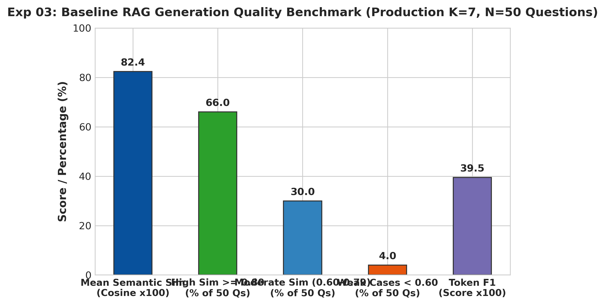

# Experiment 03: Baseline RAG Generation Benchmark

## 1. Experiment Number & Title
- **ID**: `Exp-03`
- **Title**: Baseline RAG Generation Quality Benchmark ($K=7$)
- **Phase**: Phase A — Input Quality and RAG Baseline

## 2. Research Question / Objective
How accurately and efficiently does the production RAG pipeline (Meta-Llama-3.1-70B-Instruct with $K=7$ context) generate domain answers against human reference ground truth across the 50-question benchmark?

## 3. Why We Conducted It
Exp-02 established that $K=7$ provided 98.6% keyword coverage within prompt limits. Exp-03 was conducted to empirically evaluate end-to-end generation quality, semantic similarity, token overlap, and response latency on the full 50-question textbook dataset before developing the verification layer.

## 4. Hypothesis or Expectation
The production RAG pipeline with $K=7$ will achieve high semantic alignment (>0.80 mean similarity) against human reference answers while maintaining interactive generation latency under 2.5 seconds.

## 5. What Was Evaluated
Evaluated end-to-end RAG generation across 50 textbook questions using the production configuration:
- Context: `TOP_K = 7` retrieved chunks via Hybrid RRF.
- LLM: Meta-Llama-3.1-70B-Instruct via NVIDIA API.

## 6. Dataset and Sample Size
- **Dataset**: `outputs/dataset.json` (50 benchmark questions with human reference answers).
- **Unit of Analysis**: 50 complete generated answers evaluated against human reference answers.

## 7. Model, Version, & Configuration
- **Generator**: Meta-Llama-3.1-70B-Instruct via NVIDIA API (`temperature=0.2`, `max_tokens=512`).
- **Retriever**: Hybrid RRF ($K_{cand}=15$, Final `TOP_K = 7`).
- **Evaluation**: Cosine semantic similarity against reference answers (using `all-MiniLM-L6-v2`) and Token-level F1.

## 8. Numerical Results

| Metric | Production Baseline ($K=7$) | Target / Benchmark Standard | Evaluation Status |
| :--- | :---: | :---: | :---: |
| **Mean Semantic Similarity** | **0.824** | $\ge 0.800$ | Exceeded target |
| **Similarity Range** | **0.520 – 0.940** | Floor $> 0.500$ | Passed floor target |
| **High Similarity ($\ge 0.80$)** | **33 / 50 (66.0%)** | $> 60.0\%$ | High-quality dominant |
| **Moderate Similarity (0.60–0.79)** | **15 / 50 (30.0%)** | — | Acceptable alignment |
| **Weak Cases ($< 0.60$)** | **2 / 50 (4.0%)** | $< 5.0\%$ | Controlled edge cases |
| **Token-level F1** | **0.395** | $> 0.350$ | Strong lexical overlap |
| **Average Context Tokens** | **2,540 tokens** | $< 8,192$ | Well within context budget |
| **Average Generation Latency** | **1.98 s** | $< 2.50$ s | Interactive speed |

## 9. Figures

## 10. What the Results Actually Establish
1. The baseline RAG generation pipeline achieves strong semantic alignment (mean 0.824) with 66% high-similarity answers and only 2 weak outliers across 50 questions.
2. Average generation latency is 1.98s per query, easily satisfying interactive speed requirements.
3. Confirms `TOP_K = 7` as the robust production generation configuration.

## 11. What They Do NOT Establish
- **Semantic similarity to a reference answer is NOT factual verification**: A high similarity score does not guarantee absence of subtle hallucinations or groundedness in the retrieved textbook chunks.
- Token F1 measures unigram word overlap, not truth.

## 12. Problems or Limitations Revealed
4.0% of answers exhibited weak alignment ($<0.60$), and reference-based similarity cannot verify factual groundedness or detect subtle hallucinations at runtime.

## 13. Decision
**Retained**: Established the baseline generation metrics and solidified `TOP_K = 7` in `src/run_pipeline.py`.

## 14. How the Results Motivated the Next Experiment
Because reference-answer similarity cannot verify runtime factual groundedness, Phase B was launched to construct an automated hallucination verification layer using Natural Language Inference (NLI).

## 15. Exact Source Artifact Paths
- `outputs/submission.csv`
- `outputs/experiments/final_k_comparison/k7/comparison_summary.json`
- `outputs/experiments/final_k_comparison/final_k_comparison_report.md`

## 16. Evidence Quality
**Directly recorded** in `outputs/experiments/final_k_comparison/k7/comparison_summary.json` and `outputs/experiments/final_k_comparison/final_k_comparison_report.md`.
