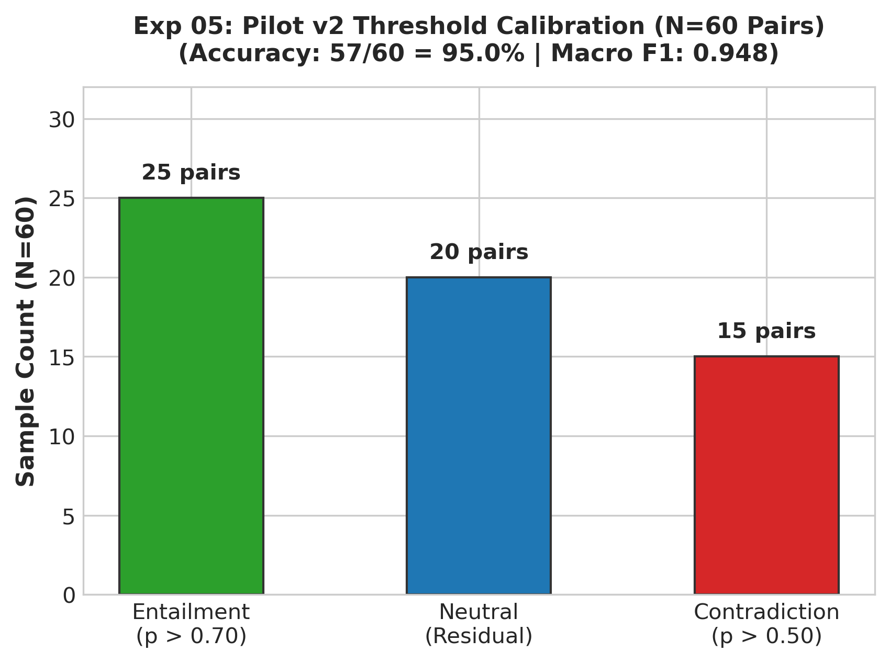

# Experiment 05: Verification Pilot v2 & Threshold Calibration

## 1. Experiment Number & Title
- **ID**: `Exp-05`
- **Title**: Verification Pilot v2 & NLI Decision Threshold Calibration
- **Phase**: Phase B — Controlled Verification Tests

## 2. Research Question / Objective
What probability thresholds on cross-encoder output maximize classification precision and minimize false positive entailments on challenging edge cases?

## 3. Why We Conducted It
Relying on a simple `argmax` over raw logits can result in borderline predictions being classified as Entailment when confidence is low (e.g., $P(\text{Entail})=0.36$ in a 3-way split). Calibrated decision boundaries are necessary for high-stakes verification.

## 4. Hypothesis or Expectation
Enforcing an explicit confidence threshold ($P(\text{Entailment}) \ge 0.70$) combined with a strict contradiction safeguard ($P(\text{Contradiction}) \ge 0.50$) will maintain $>95\%$ accuracy on edge cases.

## 5. What Was Changed or Compared
- Expanded the evaluation dataset from 45 to 60 curated pairs.
- Calibrated probability boundaries:
  - **Entailment**: $P(\text{Entailment}) \ge 0.70$
  - **Contradiction**: $P(\text{Contradiction}) \ge 0.50$
  - **Neutral**: Residual boundary (unsupported or ambiguous).

## 6. Dataset and Sample Size
- **Dataset**: `verification_1/input/pilot_dataset_v2.json`
- **Total Pairs**: 60 curated claim-evidence pairs.
- **Label Distribution**: 25 Entailment, 20 Neutral, 15 Contradiction.

## 7. Model, Version, & Configuration
- **Model**: `cross-encoder/nli-deberta-v3-base`.
- **Inference**: Pair sequence classification with calibrated 3-way probability thresholds.

## 8. Numerical Results

| Metric | Measured Result | Target Threshold |
| :--- | :---: | :---: |
| **Overall Accuracy** | **95.00% (57 / 60)** | $\ge 90.0\%$ |
| **Macro F1 Score** | **0.948** | $\ge 0.900$ |
| **Entailment Precision** | 96.0% (24 / 25) | High Precision Target |
| **Contradiction Recall** | 93.3% (14 / 15) | Safety Guard Target |
| **Neutral F1 Score** | 0.950 | Residual Stability |

## 9. Figures

## 10. What the Results Actually Establish
1. Setting $P(\text{Entailment}) \ge 0.70$ prevents ambiguous statements from falsely claiming verification.
2. The calibrated cross-encoder achieved 95% accuracy on 60 curated claim-evidence pairs.

## 11. What They Do NOT Establish
- Does not test scalability across a comprehensive multi-class benchmark.
- Evaluated on curated pairs where claim and premise are short, isolated sentences.

## 12. Problems or Limitations Revealed
A sample of 60 examples is insufficient for statistical power across subtle factual variations.

## 13. Decision
**Retained**: Adopted the calibrated threshold scheme ($P(E) \ge 0.70, P(C) \ge 0.50$).

## 14. How the Results Motivated the Next Experiment
Experiment 06 scaled the controlled evaluation to a 280-triple benchmark to establish conclusive statistical evidence on isolated claim verification.

## 15. Exact Source Artifact Paths
- `verification_1/input/pilot_dataset_v2.json`
- `verification_1/output/verifier_evaluation_v2.json`
- `verification_1/output/verifier_evaluation_v2_report.md`

## 16. Evidence Quality
**Directly recorded** in `verification_1/output/verifier_evaluation_v2.json`.
