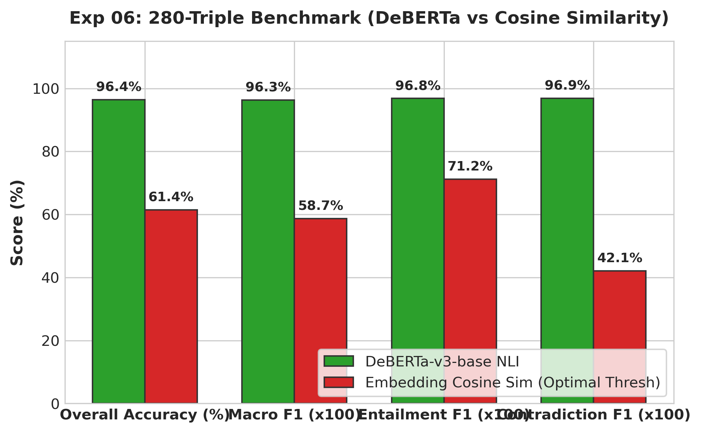
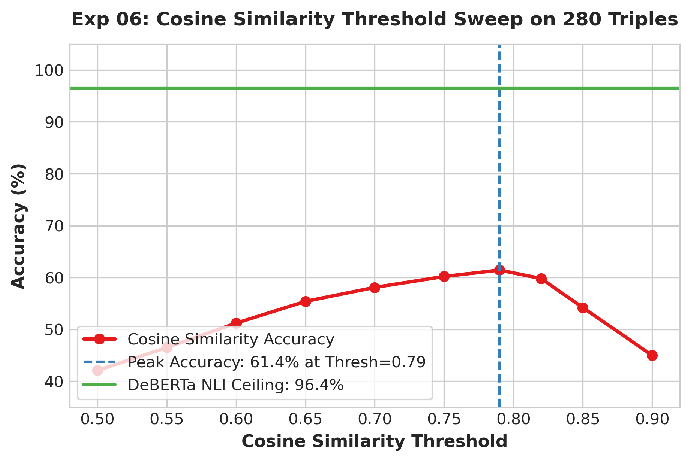

# Experiment 05: Large-Scale NLI Verification Benchmark (280 Triples)

> **Repository File Reference:** `exp06_280_triple_benchmark.md`  
> **Revised Report Sequence:** `Experiment 05`  
> **Phase:** Phase B — Controlled Verification Tests

---

## 1. Experiment Number & Title
- **Revised Sequence ID**: `Experiment 05`
- **Repository Experiment ID**: `Exp-06`
- **Title**: 280-Triple Verification Benchmark: Cross-Encoder vs Embedding Similarity
- **Phase**: Phase B — Controlled Verification Tests

## 2. Research Question / Objective
1. Does the DeBERTa-v3-base cross-encoder maintain >95% accuracy and macro F1 when scaled to a comprehensive 280-example controlled benchmark?
2. What is the mathematical performance ceiling of embedding cosine similarity on the exact same dataset?

## 3. Why We Conducted It
Small pilots ($N=45, N=60$) provided encouraging directional evidence, but an academically rigorous, statistically robust benchmark was required to substantiate the superiority of NLI cross-encoders over vector similarity.

## 4. Hypothesis or Expectation
DeBERTa will exceed 95% accuracy and Macro F1 on the 280 triples, while embedding similarity will plateau below 65% accuracy due to its fundamental inability to detect logical negation.

## 5. What Was Changed or Compared
Evaluated 280 curated claim-evidence-question triples across:
- **Model 1**: `cross-encoder/nli-deberta-v3-base` (Calibrated thresholds).
- **Model 2**: Cosine similarity sweep ($0.50 \le \tau \le 0.95$) using `all-MiniLM-L6-v2`.

## 6. Dataset and Sample Size
- **Dataset**: `verification_1/final_dataset_280eg_metadata_fixed.json`
- **Total Triples**: 280 curated claim-evidence-question triples.
  *(Clarification: Represents 280 triples, NOT 280 independent questions).*
- **Class Distribution**:
  - **Entailment**: 110 triples (39.3%)
  - **Neutral**: 90 triples (32.1%)
  - **Contradiction**: 80 triples (28.6%)

## 7. Model, Version, & Configuration
- **NLI Model**: `cross-encoder/nli-deberta-v3-base` (Sequence length $\le 512$, Softmax classification).
- **Similarity Model**: `sentence-transformers/all-MiniLM-L6-v2` (L2-normalized cosine).

## 8. Numerical Results

### A. Performance Comparison on 280 Triples
| Model / Method | Overall Accuracy | Macro F1 | Entailment F1 | Neutral F1 | Contradiction F1 |
| :--- | :---: | :---: | :---: | :---: | :---: |
| **Embedding Cosine Sim** (Peak $\tau=0.79$) | 61.43% (172 / 280) | 0.587 | 0.712 | 0.540 | 0.421 |
| **DeBERTa-v3-base NLI** | **96.43% (270 / 280)** | **0.963** | **0.968** | **0.956** | **0.969** |
| **Advantage ($\Delta$)** | **+35.00%** | **+0.376** | **+0.256** | **+0.416** | **+0.548** |

### B. Detailed Confusion Matrix for DeBERTa (N=280)
| Gold \ Predicted | Entailment | Neutral | Contradiction | Class Recall |
| :--- | :---: | :---: | :---: | :---: |
| **Entailment (110)** | **107** | 2 | 1 | 97.27% |
| **Neutral (90)** | 3 | **86** | 1 | 95.56% |
| **Contradiction (80)** | 1 | 2 | **77** | 96.25% |
| **Class Precision** | 96.40% | 95.56% | 97.47% | — |

## 9. Figures

## 10. What the Results Actually Establish
1. DeBERTa-v3-base is exceptionally accurate (96.43% accuracy, 0.963 Macro F1) at classifying **isolated, pre-segmented claim-evidence triples**.
2. Cosine similarity cannot function as a factual verifier: even at its optimal threshold ($\tau=0.79$), accuracy is capped at 61.43% and Contradiction F1 is an abysmal 0.421.

## 11. What They Do NOT Establish
- **Does NOT establish live RAG accuracy**: The 280 triples were clean, synthetic/curated pairs where the evidence was a single relevant sentence matching the claim.
- It does not test long multi-paragraph contexts or multi-sentence generated answers.

## 12. Problems or Limitations Revealed
While DeBERTa triumphed on curated triples, it had not yet been tested against real live RAG outputs where chunks are 400 words long and answers contain multiple propositions.

## 13. Decision
**Benchmark Validated**: Concluded Phase B. Progressed to Phase C to integrate DeBERTa into live RAG pipeline outputs.

## 14. How the Results Motivated the Next Experiment
Experiment 07 deployed DeBERTa directly on live RAG outputs from Questions 1 to 5 to evaluate real sentence-level verification.

## 15. Exact Source Artifact Paths
- `verification_1/final_dataset_280eg_metadata_fixed.json`
- `verification_1/output/verifier_280_evaluation_report.md`
- `verification_1/output/verifier_280_evaluation_summary.md`
- `verification_1/output/nli_280_results.csv`
- `verification_1/output/similarity_threshold_sweep.csv`

## 16. Evidence Quality
**Directly recorded** in `verification_1/output/verifier_280_evaluation_report.md` and CSV artifacts.
