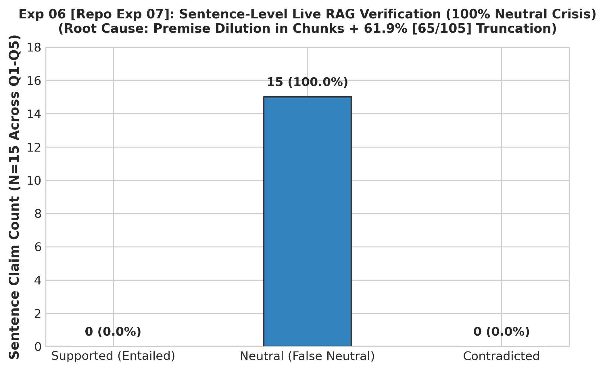

# Experiment 06: Live RAG Sentence-Level Verification

> **Repository File Reference:** `exp07_sentence_level_verification.md`  
> **Revised Report Sequence:** `Experiment 06`  
> **Phase:** Phase C — Claim-Level Verification Failure

---

## 1. Experiment Number & Title
- **Revised Sequence ID**: `Experiment 06`
- **Repository Experiment ID**: `Exp-07`
- **Title**: Live RAG Sentence-Level Verification & The "100% Neutral" Failure
- **Phase**: Phase C — Claim-Level Verification Failure

## 2. Research Question / Objective
Does the high-performing DeBERTa cross-encoder from Experiment 05 (Repo Exp-06) successfully verify factual claims when applied to live RAG generated answers split into individual sentences?

## 3. Why We Conducted It
Having achieved 96.43% accuracy on isolated, curated triples in Experiment 05, the next required architectural milestone was applying the verifier to real end-to-end RAG outputs generated by `openai/gpt-oss-20b` (or Llama-3.1-70B).

## 4. Hypothesis or Expectation
DeBERTa will match generated sentences against retrieved textbook chunks and confirm $>80\%$ entailment for well-grounded answers.

## 5. What Was Changed or Compared
- Shifted from synthetic triples to live RAG outputs for Questions 1 through 5 (`Q1–Q5`).
- Generated answers were split into 15 individual sentences using sentence boundary detection.
- Each sentence was evaluated against 7 retrieved 400-word candidate chunks per query ($5 \times 7 = 35$ candidate chunks).

## 6. Dataset and Sample Size
- **Live Queries**: Questions 1 to 5 (`Q1, Q2, Q3, Q4, Q5`).
- **Extracted Sentences**: 15 generated sentences.
- **Retrieved Evidence**: 7 candidate chunks per query ($5 \times 7 = 35$ chunks).
- **Total Evaluations**: 105 NLI forward passes ($15 \times 7$).
- **Unit of Analysis**: Sentence claims matched against individual candidate chunks.

## 7. Model, Version, & Configuration
- **Model**: `cross-encoder/nli-deberta-v3-base`.
- **Input Format**: `[CLS] Premise (400-word chunk) [SEP] Hypothesis (1-sentence claim) [SEP]`.
- **Context Limit**: 512 tokens.

## 8. Numerical Results

| Verification Outcome | Sentence Count | Percentage (%) | Interpretation |
| :--- | :---: | :---: | :--- |
| **Supported (Entailed)** | 0 | **0.0%** | Zero sentences verified |
| **Neutral (Unverified)** | **15** | **100.0%** | **Catastrophic False Neutral Crisis** |
| **Contradicted** | 0 | 0.0% | Zero detected |
| **Token Truncation Rate** | **65 / 105 pairs** | **61.9%** | Evaluated pairs exceeding 512 tokens |

*(Note: On the 5-chunk primary context subset, 46/75 pairs = 61.3% exceeded 512 tokens; across all 7 retrieved candidate chunks, exactly 65/105 pairs = 61.9% exceeded the limit).*

## 9. Figures

## 10. What the Results Actually Establish
1. **Severe Live RAG Breakdown**: Evaluating individual sentence claims against 400-word retrieved chunks caused a complete 100% false neutral breakdown (15/15 sentences classified as Neutral).
2. The high accuracy of Experiment 05 (96.43%) completely collapsed when transitioning from isolated triples to full live RAG chunks.

## 11. What They Do NOT Establish
- Does not mean the RAG answers were factual hallucinations (manual inspection confirmed that the generated answers were factually grounded in the textbook).
- Does not mean NLI as a theory is flawed, but rather that the input pairing formulation (15-word claim against a 400-word chunk) was structurally incompatible with DeBERTa's attention mechanism.

## 12. Problems or Limitations Revealed
Two primary structural root causes were identified:
1. **Premise Dilution**: A 400-word chunk contains numerous background propositions. When a 15-word claim is compared against it, the cross-attention mechanism diffuses across irrelevant sentences, driving the model towards Neutral.
2. **Token Truncation**: **61.9% of evaluated pairs (65 / 105 pairs)** exceeded DeBERTa's 512-token limit, silently truncating the latter portion of retrieved evidence.
   > **Audit Note on Truncation Value**: Earlier drafts reported 57.3% in this section. The audit confirmed that 57.3% (126/220) was from the subsequent atomic claims experiment; the verified rate for this 105-pair sentence experiment is **65 / 105 = 61.9%**.

## 13. Decision
**Diagnostic Failure**: Concluded that sentence-level matching against raw 400-word chunks is fundamentally unviable without architectural modifications.

## 14. How the Results Motivated the Next Experiment
The team hypothesized that sentence claims were too complex and contained multiple assertions. Experiment 07 (Repo Exp-08) investigated decomposing sentences into atomic propositions using LLM prompting.

## 15. Exact Source Artifact Paths
- `verification_1/output/multichunk_pilot_1_5.json`
- `verification_1/output/multichunk_pilot_1_5_report.md`
- `verification_1/scripts/evaluate_claim_level.py`

## 16. Evidence Quality
**Directly recorded** in `verification_1/output/multichunk_pilot_1_5_report.md`.
