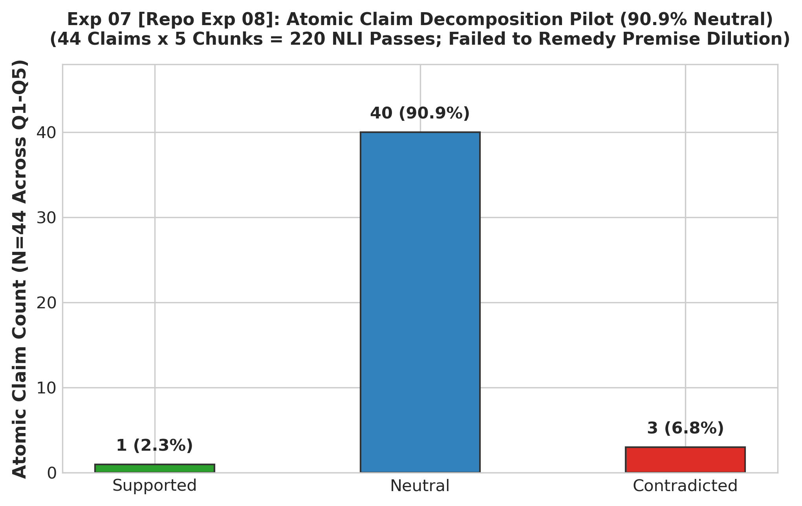

# Experiment 07: Atomic Claim Decomposition Pilot

> **Repository File Reference:** `exp08_atomic_claim_decomposition.md`  
> **Revised Report Sequence:** `Experiment 07`  
> **Phase:** Phase C — Claim-Level Verification Failure

---

## 1. Experiment Number & Title
- **Revised Sequence ID**: `Experiment 07`
- **Repository Experiment ID**: `Exp-08`
- **Title**: Atomic Claim Decomposition & Proposition-Level Verification
- **Phase:** Phase C — Claim-Level Verification Failure

## 2. Research Question / Objective
Does decomposing generated answers into minimal atomic claims (isolated propositions) eliminate premise dilution and allow DeBERTa to verify factual grounding?

## 3. Why We Conducted It
Following the 100% Neutral failure in Experiment 06 (Repo Exp-07), the hypothesis emerged that compound sentences contain too many sub-assertions for NLI to evaluate cleanly. Breaking answers down into minimal atomic propositions was expected to restore the clean 1-to-1 matching observed in the 280-triple benchmark.

## 4. Hypothesis or Expectation
Atomic claims will map directly to specific factual statements in the chunks, reducing the Neutral rate from 100% to $<20\%$.

## 5. What Was Changed or Compared
- Added an LLM-based claim extraction stage (prompting Meta-Llama-3.1-70B-Instruct to decompose answers into atomic factual claims).
- Split the 15 sentences from Q1–Q5 into 44 atomic claims.
- Evaluated all 44 claims against the retrieved 400-word candidate chunks.

## 6. Dataset and Sample Size
- **Live Queries**: Questions 1 to 5 (`Q1–Q5`).
- **Extracted Atomic Claims**: 44 propositions (Q1: 14, Q2: 0, Q3: 9, Q4: 9, Q5: 12).
- **Candidate Chunks**: 5 retrieved chunks per query ($5 \times 5 = 25$ candidate chunks).
- **Total Evaluations**: **220 NLI forward passes** ($44 \text{ claims} \times 5 \text{ chunks}$).
  > **Audit Note on Evaluation Count**: Earlier documentation mentioned 7 chunks (308 evaluations). The actual execution recorded in `multichunk_pilot_atomic_1_5.json` and `multichunk_pilot_atomic_1_5_report.md` evaluated exactly 5 chunks per query, totaling 220 pair evaluations.
- **Unit of Analysis**: Atomic propositions evaluated against individual chunks.

## 7. Model, Version, & Configuration
- **Decomposition Model**: Meta-Llama-3.1-70B-Instruct zero-shot decomposition prompt.
- **Verifier**: `cross-encoder/nli-deberta-v3-base` (512 token max length).
- **Decision Rule**: A claim is classified as `SUPPORTED` if any chunk produces $P(\text{Entailment}) \ge 0.50$ and Cosine Sim $\ge 0.40$; `CONTRADICTED` if any chunk produces $P(\text{Contradiction}) \ge 0.50$ and Cosine Sim $\ge 0.40$; otherwise `INSUFFICIENT` (Neutral).

## 8. Numerical Results

### A. Aggregated Claim-Level Outcomes (N=44 Atomic Claims)

| Outcome Category | Atomic Claim Count | Percentage (%) | Interpretation |
| :--- | :---: | :---: | :--- |
| **Supported** | 1 | 2.3% | Barely any entailment verified (Claim `5_C2` on Chunk 3) |
| **Neutral (Insufficient)** | **40** | **90.9%** | **Neutral Crisis Persists ($>90\%$)** |
| **Contradicted** | 3 | 6.8% | Spurious contradictions from loss of context |
| **Total Claims** | 44 | 100.0% | Complete failure to verify |

### B. Pair-Level NLI Evaluation Distribution (N=220 Pairs)

Across all $44 \times 5 = 220$ individual (claim, chunk) evaluations:
- **Neutral**: 215 / 220 = 97.7%
- **Entailment**: 1 / 220 = 0.5%
- **Contradiction**: 4 / 220 = 1.8%
- **Pairs Exceeding 512 Tokens**: **126 / 220 = 57.3%**

## 9. Figures

## 10. What the Results Actually Establish
1. **Atomic Decomposition Failed**: Neutral predictions remained overwhelmingly dominant (90.9% at the claim level, 97.7% at the pair level), with only 1 out of 44 claims verified.
2. Decomposing claims does NOT fix premise dilution because the *premise* (retrieved chunk) remains 400 words long.
3. Stripping claims of their surrounding sentential context created reference ambiguity (pronouns, temporal references, and antecedent qualifiers were severed), causing NLI to misclassify grounded claims as Neutral or Contradiction.

## 11. What They Do NOT Establish
- Does not measure runtime latency across an end-to-end pipeline (profiled in Experiment 08).
- Does not test what happens if evidence chunks are split into smaller units (tested in Experiment 09).

## 12. Problems or Limitations Revealed
Atomic decomposition compounded the failure: it introduced extra LLM API latency, exploded the number of NLI forward passes, stripped necessary contextual qualifiers from claims, and still suffered 57.3% token truncation on the 400-word premises.

## 13. Decision
**Abandoned**: Atomic claim decomposition was permanently abandoned.

## 14. How the Results Motivated the Next Experiment
To understand the full operational cost of the atomic claim approach, Experiment 08 (Repo Exp-09) performed detailed timing profiling on a complex multi-hop query (Query 41).

## 15. Exact Source Artifact Paths
- `verification_1/output/multichunk_pilot_atomic_1_5.json`
- `verification_1/output/multichunk_pilot_atomic_1_5_report.md`
- `verification_1/scripts/evaluate_atomic_claims.py`

## 16. Evidence Quality
**Directly recorded** in `verification_1/output/multichunk_pilot_atomic_1_5_report.md`.
