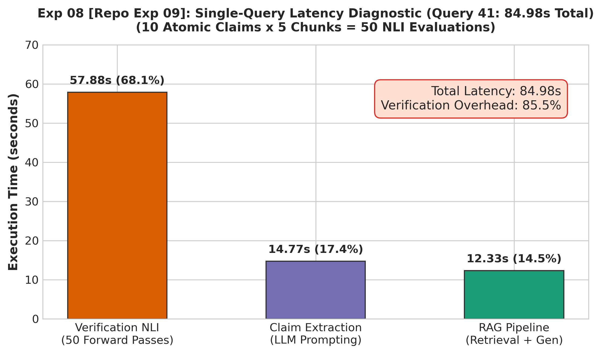

# Experiment 08: Atomic Claim-Level Latency Diagnostic on Query 41

> **Repository File Reference:** `exp09_latency_diagnostic.md`  
> **Revised Report Sequence:** `Experiment 08`  
> **Phase:** Phase C — Claim-Level Verification Failure

---

## 1. Experiment Number & Title
- **Revised Sequence ID**: `Experiment 08`
- **Repository Experiment ID**: `Exp-09`
- **Title**: Atomic Claim-Level Latency Diagnostic on Complex Query 41
- **Phase**: Phase C — Claim-Level Verification Failure

## 2. Research Question / Objective
What is the exact end-to-end computational latency breakdown of the atomic claim decomposition and verification pipeline on a representative complex query?

## 3. Why We Conducted It
In addition to the qualitative failure (>90% Neutral in Exp-08), preliminary runs felt unacceptably slow. Rigorous, component-by-component timing instrumentation was required to measure the true operational overhead of claim extraction and combinatorial NLI matching.

## 4. Hypothesis or Expectation
Claim-level verification will exceed 30 seconds due to the quadratic multiplication of claims and candidate chunks ($N_{\text{claims}} \times K_{\text{chunks}}$).

## 5. What Was Changed or Compared
Profiled full end-to-end execution on Query 41 (a complex multi-part query), measuring:
1. Retrieval and RAG generation time.
2. LLM atomic claim extraction time.
3. NLI cross-encoder forward pass inference time.

## 6. Dataset and Sample Size
- **Sample**: 1 query (Query 41, representative multi-hop question).
- **Extracted Claims**: 10 atomic claims.
- **Candidate Chunks**: 5 retrieved chunks.
- **NLI Evaluations**: 50 individual cross-encoder forward passes ($10 \times 5$).
- **Unit of Analysis**: Seconds per processing stage on CPU.

## 7. Model, Version, & Configuration
- **LLM**: Meta-Llama-3.1-70B-Instruct (RAG answer generation and claim extraction).
- **Verifier**: `cross-encoder/nli-deberta-v3-base` (PyTorch CPU inference, batch size = 1).

## 8. Numerical Results

| Pipeline Component | Execution Time (s) | Share of Total (%) | Description |
| :--- | :---: | :---: | :--- |
| **Claim Extraction (LLM)** | 14.77 s | 17.4% | Extra API call to decompose answer |
| **NLI Inference (DeBERTa)** | **57.88 s** | **68.1%** | **50 sequential forward passes on CPU** |
| **Verification Overhead Total** | **72.65 s** | **85.5%** | **Combined verification bottleneck** |
| **RAG Pipeline (Retrieval + Gen)** | 12.33 s | 14.5% | Original RAG response time |
| **Total End-to-End Latency** | **84.98 s** | **100.0%** | **Over 1.4 minutes per query** |

## 9. Figures

## 10. What the Results Actually Establish
1. **Intolerable Operational Bottleneck**: Total latency reached **84.98 seconds** for a single query.
2. Verification accounted for **85.5% of total query latency** (57.88s in NLI forward passes + 14.77s in claim decomposition).
3. The combinatorial explosion ($N_{\text{claims}} \times K_{\text{chunks}} = 50$ passes) makes claim-level cross-encoder verification computationally unviable for any interactive production system.

## 11. What They Do NOT Establish
- **Sample Size Caveat**: This is a detailed single-query diagnostic on a complex query ($N=1$, 10 claims), not an aggregate average across the full 50-question benchmark.
- Does not reflect GPU acceleration (run on CPU).

## 12. Problems or Limitations Revealed
Even if the Neutral accuracy problem could be resolved, the pipeline was practically unusable due to execution times approaching 1.5 minutes per query.

## 13. Decision
**Diagnostic Proved Claim-Level Architecture Unviable**: Mandated an architectural paradigm shift to eliminate LLM claim extraction and drastically reduce the number of NLI forward passes.

## 14. How the Results Motivated the Next Experiment
Before abandoning claim-level matching entirely, Experiment 10 tested whether splitting evidence chunks into 3-sentence micro-units could fix premise dilution and reduce comparisons.

## 15. Exact Source Artifact Paths
- `verification_1/output/query41_granularity_test.json`
- `verification_1/output/query41_granularity_test.md`
- `verification_1/output/single_query_diagnostic.json`

## 16. Evidence Quality
**Directly recorded** in `verification_1/output/query41_granularity_test.json`.
