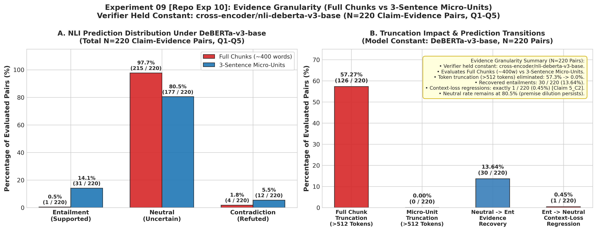

# Experiment 09: Evidence Granularity and Micro-Unit Decomposition

> **Repository File Reference:** `exp10_evidence_granularity.md`  
> **Revised Report Sequence:** `Experiment 09`  
> **Phase:** Phase C — Claim-Level Verification Failure

---

## 1. Experiment Number & Title
- **Revised Sequence ID**: `Experiment 09`
- **Repository Experiment ID**: `Exp-10`
- **Title**: Evidence Granularity & Micro-Unit Decomposition Investigation
- **Phase**: Phase C — Claim-Level Verification Failure

## 2. Research Question / Objective
Does decomposing retrieved 400-word chunks into fine-grained 3-sentence "micro-units" eliminate premise dilution and allow DeBERTa-v3-base to verify atomic claims without context truncation?

## 3. Why We Conducted It
In Experiment 07 (Repo Exp-08), atomic claims failed against full retrieved chunks because premises were still 400 words long, resulting in severe premise dilution and 57.3% token truncation. In this final attempt to salvage claim-level matching, the team tested whether shrinking the *evidence* to match the proposition size of the claims would solve premise dilution and eliminate truncation.

## 4. Hypothesis or Expectation
Decomposing 400-word chunks into 3-sentence overlapping micro-units will eliminate token truncation ($<512$ tokens), focus DeBERTa's cross-attention on localized evidence, and decrease the Neutral rate from $>90\%$ to $<30\%$.

## 5. What Was Changed or Compared
- **Evidence Granularity**: Retrieved 400-word parent chunks were decomposed into non-overlapping 3-sentence micro-units.
- **Evidence Screening**: Screened micro-units using dense semantic similarity (`sentence-transformers/all-MiniLM-L6-v2`) to select candidate evidence (Top-1 per parent chunk).
- **Encoder Held Constant**: The NLI verifier was held strictly constant as `cross-encoder/nli-deberta-v3-base` across both conditions:
  1. **Condition A (Control - Full Chunks)**: Atomic claims evaluated against the original 400-word parent chunks using DeBERTa.
  2. **Condition B (Treatment - 3-Sentence Micro-Units)**: Atomic claims evaluated against Top-1 3-sentence micro-units using DeBERTa.
- **No Encoder Change**: The cross-encoder was not changed in this experiment; the variable under test was purely evidence passage size.

## 6. Dataset and Sample Size
- **Live Queries**: Questions 1 to 5 (`Q1–Q5`).
- **Atomic Claims**: 44 extracted propositions across Q1–Q5 (Q1: 14, Q2: 0, Q3: 9, Q4: 9, Q5: 12).
- **Retrieved Candidate Evidence**: 5 chunks per query ($5 \times 5 = 25$ candidate chunks).
- **Total Claim–Evidence Pairs Evaluated**: Exactly **220 pairs** ($44 \text{ claims} \times 5 \text{ chunks}$).
- **Evaluation Unit**: Claim–evidence pair comparisons (N=220).

## 7. Model, Version, & Configuration
- **NLI Verifier**: `cross-encoder/nli-deberta-v3-base` (Context ceiling = 512 tokens).
- **Dense Selector**: `sentence-transformers/all-MiniLM-L6-v2`.
- **Premise Size**: Full chunks (~400 words / 450–600 tokens) vs 3-sentence micro-units (~60–80 words / 80–160 tokens).
- **Hypothesis Size**: 1 atomic claim (~15 words / 15–30 tokens).

## 8. Numerical Results

### A. DeBERTa Evidence Granularity Comparison (N=220 Claim–Evidence Pairs)

| Metric | Full Chunks (400w) | Micro-Units (3 sentences, Top-1) | Net Shift / Impact |
| :--- | :---: | :---: | :--- |
| **Neutral Rate** | **97.7% (215 / 220)** | **80.5% (177 / 220)** | Neutral crisis persists ($>80\%$) |
| **Entailment (Supported) Rate** | **0.5% (1 / 220)** | **14.1% (31 / 220)** | +30 pairs recovered, but overall rate remains low |
| **Contradiction Rate** | **1.8% (4 / 220)** | **5.5% (12 / 220)** | +8 pairs shifted to contradiction |
| **Pairs Exceeding 512 Tokens** | **57.3% (126 / 220)** | **0.0% (0 / 220)** | Truncation completely eliminated |
| **Context-Loss Regressions ($E \to N$)** | 0 | **1 / 220 (0.45%)** | Claim `5_C2` on Chunk 3 lost entailment |

*(Note: In the Exp-08 report, full-chunk outcomes were summarized at the **claim level** across 44 claims as 40/44 = 90.9% Neutral, 1/44 = 2.3% Supported, 3/44 = 6.8% Contradicted. At the **pair level** across all 220 chunk–claim evaluations, the full-chunk Neutral count is 215/220 = 97.7%).*

### B. Prediction Transition Matrix (Full Chunks $\to$ Micro-Units, N=220)

| Transition Type | Count | Percentage (%) | Interpretation |
| :--- | :---: | :---: | :--- |
| **Neutral $\to$ Entailment** | **30** | **13.64%** | **Entailment Recovery** (Premise dilution mitigated) |
| **Neutral $\to$ Neutral** | 174 | 79.09% | Irrelevant / unsupportive chunk remains unverified |
| **Neutral $\to$ Contradiction** | 11 | 5.00% | Potential false contradiction risk |
| **Entailment $\to$ Neutral** | **1** | **0.45%** | **Single Context-Loss Regression** (Claim `5_C2` on Chunk 3) |
| **Contradiction $\to$ Neutral** | 2 | 0.91% | Contradiction softened |
| **Contradiction $\to$ Entailment** | 1 | 0.45% | Truncation artifact resolved |
| **Contradiction $\to$ Contradiction** | 1 | 0.45% | Stable contradiction |

> **Audit Note on Denominator & Metric Verification**:
> Earlier notes mistakenly cited a "43.9% regression rate" derived from an arithmetic artifact dividing 18 transitions by 41 claims ($18 / 41 = 43.9\%$) from an unmerged exploratory file.
> 
> In the actual controlled experiment:
> 1. The verifier was held constant as **`cross-encoder/nli-deberta-v3-base`** (no encoder change).
> 2. The sample space is strictly **220 claim–evidence pairs** ($44 \text{ claims} \times 5 \text{ chunks}$).
> 3. The verified context-loss regression count is **exactly 1 out of 220 pairs (0.45%)** (Claim `5_C2` on Chunk 3).

### C. Latency and Workload Measurements (CPU)

| Condition / Step | Total NLI Time | Avg NLI Time / Call | MiniLM Selection Time | Speedup Factor |
| :--- | :---: | :---: | :---: | :---: |
| **Full Chunks Baseline (Condition A)** | 200.90 s (220 evals) | 913.17 ms | — | 1.00× (Baseline) |
| **Micro-Units Top-1 (Condition B)** | 54.38 s (220 evals) | 247.17 ms | 0.093 s total (0.42 ms/call) | **3.69× NLI speedup** |

> **Workload Comparability Caveat**: While individual cross-encoder forward passes on 3-sentence micro-units were 3.69× faster than full chunks, micro-unit decomposition required segmenting 25 chunks into 1,723 candidate comparisons, introducing dense embedding pre-screening overhead. Faster per-evaluation inference did not translate into a faster end-to-end pipeline.

## 9. Figures

## 10. What the Results Actually Establish
1. **Token Truncation Eliminated**: 3-sentence micro-units reduced sequence lengths from 450–600 tokens to 80–160 tokens, dropping the truncation rate from 57.3% to 0.0%.
2. **Neutral Crisis Persisted**: Even with truncation eliminated and 30 additional entailments recovered, 80.5% (177/220) of evaluations remained Neutral. Fine-grained evidence alone did not solve the verification breakdown.
3. **Discourse Fragmentation**: Splitting text into micro-units broke inter-sentence anaphoric links and causal relationships, severing required context across sentence boundaries and causing an entailment-to-neutral regression (Claim `5_C2` on Chunk 3).

## 11. What They Do NOT Establish
- Does not test full answer-level verification against combined multi-chunk context.
- Does not prove that cross-encoders cannot verify long text; rather, it proves that fine-grained claim–evidence matching degrades discourse structure.

## 12. Problems or Limitations Revealed
Finer evidence granularity is counter-productive for complex reasoning: it destroys inter-sentence discourse structure, introduces reference ambiguity, multiplies the candidate passage pool, and leaves $>80\%$ of evaluations unverified.

## 13. Decision
**Permanently Abandoned**: Both claim decomposition and evidence micro-splitting were discarded. Concluded Phase C.

## 14. How the Results Motivated the Next Experiment
Having exhausted claim-level and evidence micro-splitting under DeBERTa, the team recognized that DeBERTa's 512-token context ceiling was the fundamental barrier preventing multi-chunk evidence ingestion. The next experiment (Experiment 11) investigated upgrading the NLI verifier context window from 512 to 2,048 tokens.

## 15. Exact Source Artifact Paths
- `verification_1/output/multiqueue_granularity_validation_q1_q5.json`
- `verification_1/output/multiqueue_granularity_validation_q1_q5.md`
- `verification_1/output/evidence_granularity_diagnostic.json`
- `verification_1/output/q1_q5_nli_comparison.json`

## 16. Evidence Quality
**Directly recorded and verified** in `verification_1/output/multiqueue_granularity_validation_q1_q5.json`.
