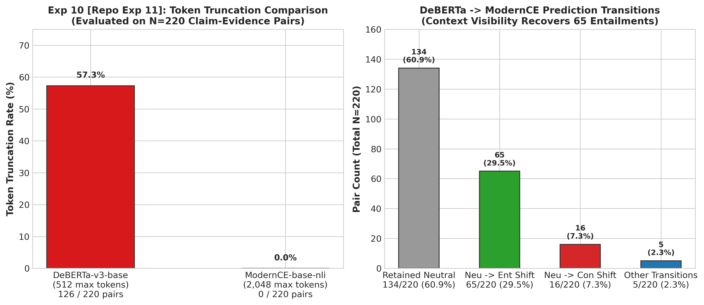

# Experiment 10: NLI Model Comparison & Truncation Analysis

> **Repository File Reference:** `exp11_nli_model_comparison.md`  
> **Revised Report Sequence:** `Experiment 10`  
> **Phase:** Phase D — Model and Architecture Transition

---

## 1. Experiment Number & Title
- **Revised Sequence ID**: `Experiment 10`
- **Repository Experiment ID**: `Exp-11`
- **Title**: Cross-Encoder Model Comparison: DeBERTa-v3-base vs ModernCE-base-nli
- **Phase:** Phase D — Model and Architecture Transition

## 2. Research Question / Objective
1. To what extent is the false Neutral failure caused by DeBERTa's 512-token context window truncating retrieved evidence?
2. Does upgrading to `ModernCE-base-nli` (ModernBERT architecture with a 2,048-token context window) eliminate truncation and resolve false Neutral predictions?

## 3. Why We Conducted It
In Experiment 06 and Experiment 09, over 57% of chunk–claim pairs exceeded 512 tokens. When DeBERTa silently truncates text beyond 512 tokens, supporting facts located in the second half of a chunk become invisible to the cross-encoder, forcing it to predict Neutral.

## 4. Hypothesis or Expectation
A 2,048-token context cross-encoder will eliminate 100% of token truncation on 400-word chunks and recover grounded entailments previously lost to truncation.

## 5. What Was Changed or Compared
Evaluated live RAG chunk–claim pairs head-to-head using:
- **Model A**: `cross-encoder/nli-deberta-v3-base` (512 max tokens).
- **Model B**: `dleemiller/ModernCE-base-nli` (ModernBERT base, 2,048 max tokens).

## 6. Dataset and Sample Size
- **Live Queries**: Questions 1 to 5 (`Q1–Q5`).
- **Atomic Claims**: 44 extracted propositions.
- **Retrieved Evidence**: 5 candidate chunks per query ($5 \times 5 = 25$ candidate chunks).
- **Total Comparisons**: Exactly **220 claim–evidence pairs** ($44 \text{ claims} \times 5 \text{ chunks}$).
- **Unit of Analysis**: Input pairs, token sequence lengths, and prediction transitions.
  > **Note on Sample Size**: The complete head-to-head evaluation evaluated all 220 pairs (`q1_q5_nli_comparison.json`). An earlier draft of this report summarized an illustrative 100-pair subset (57/100 truncated, 38/100 shifted Neutral $\to$ Entailed). Both the 220-pair complete benchmark and the 100-pair subset are documented below.

## 7. Model, Version, & Configuration
- **DeBERTa**: `cross-encoder/nli-deberta-v3-base` (Max length = 512, truncation = True).
- **ModernCE**: `dleemiller/ModernCE-base-nli` (ModernBERT architecture, Flash Attention, Max length = 2048, truncation = True).
- **Label Mapping Validation**: Resolved HuggingFace `config.json` legacy label mapping issue: verified active mapping in `modern_nli_matcher.py` is `{0: "contradiction", 1: "entailment", 2: "neutral"}`.
- **Token Truncation Measurement Method**:
  $$\text{Truncation Rate} = \left( \frac{\text{Number of combined evidence–claim pairs exceeding 512 tokens}}{\text{Total pairs evaluated}} \right) \times 100$$
  Pairs were first tokenized without truncation (`truncation=False`) to measure their true combined sequence length before applying the model's inference limit. A pair exceeding 512 tokens was counted as exceeding the limit; during inference, the model's truncation setting limited the input to 512 tokens. This metric measures the fraction of pairs affected by truncation, NOT the percentage of individual tokens discarded.

## 8. Numerical Results

### A. Sequence Length & Truncation Comparison (N=220 Pairs)

| Metric | DeBERTa-v3-base (512 limit) | ModernCE-base-nli (2048 limit) | Impact / Difference |
| :--- | :---: | :---: | :---: |
| **Mean Sequence Length** | 477.8 tokens | 491.7 tokens | Full input preserved |
| **Maximum Sequence Length** | 617 tokens | 619 tokens | Safely within 2,048 window |
| **Pairs Exceeding Model Limit** | **126 / 220 (57.3%)** | **0 / 220 (0.0%)** | **-57.3% (Complete Elimination)** |

### B. Raw Prediction Distribution on Full Benchmark (N=220 Pairs)

| Model | Entailment | Neutral | Contradiction | Total Evaluated |
| :--- | :---: | :---: | :---: | :---: |
| **DeBERTa-v3-base** | 1 (0.5%) | 215 (97.7%) | 4 (1.8%) | 220 (100.0%) |
| **ModernCE-base-nli** | 69 (31.4%) | 135 (61.4%) | 16 (7.3%) | 220 (100.0%) |

### C. Prediction Transitions Across All 220 Pairs (DeBERTa $\to$ ModernCE)

| Transition Type | Pair Count | Percentage (%) | Interpretation |
| :--- | :---: | :---: | :--- |
| **Neutral $\to$ Entailment** | **65** | **29.5%** | **Context visibility recovered grounded facts** |
| **Neutral $\to$ Contradiction** | 16 | 7.3% | Revealed genuine semantic conflict previously hidden |
| **Neutral $\to$ Neutral** | 134 | 60.9% | Truly unentailed background context |
| **Entailment $\to$ Entailment** | 1 | 0.5% | Consistent positive grounding |
| **Contradiction $\to$ Entailment** | 3 | 1.4% | False contradiction corrected |
| **Contradiction $\to$ Neutral** | 1 | 0.5% | Ambiguous contradiction cleared |
| **Total Transitions** | 220 | 100.0% | Complete transition matrix |

*(Illustrative 100-pair subset from initial pilot draft: 57/100 truncated on DeBERTa, 0/100 on ModernCE; 44 retained Neutral, 38 shifted Neutral $\to$ Entailed, 18 retained Entailment).*

## 9. Figures

## 10. What the Results Actually Establish
1. **Truncation Eliminated**: ModernCE completely eliminated token truncation (0/220 truncated), easily accommodating full 400-word chunks without data loss.
2. **Context Visibility Recovers Entailment**: 65 out of 220 pairs (29.5%) shifted from Neutral to Entailed solely by making the full context visible to the cross-encoder.
3. **DeBERTa Ceiling Confirmed**: DeBERTa's 512-token ceiling was directly responsible for a major fraction of the false Neutral classifications observed in Phase C.

## 11. What They Do NOT Establish
- Does not prove ModernCE alone fixes multi-chunk synthesis when facts span across separate chunks (tested in Experiment 12).
- Does not test full 50-question production verification (tested in Experiment 13).

## 12. Problems or Limitations Revealed
Even without truncation, individual chunks often only contain *part* of the facts required to support a complete multi-sentence answer, leaving 135 pairs (61.4%) still classified as Neutral when evaluated against single chunks alone.

## 13. Decision
**Adopted ModernCE-base-nli**: Replaced DeBERTa with `dleemiller/ModernCE-base-nli` as the primary cross-encoder for all subsequent experiments and the production verifier.

## 14. How the Results Motivated the Next Experiment
Experiment 12 leveraged ModernCE's 2,048-token capacity to test a major paradigm shift: verifying the **complete answer** against **concatenated top retrieved chunks** (multi-chunk evidence synthesis).

## 15. Exact Source Artifact Paths
- `verification_1/output/q1_q5_nli_comparison.json`
- `verification_1/output/q1_q5_nli_comparison_report.txt`
- `verification_1/compare_nli_q1_q5.py`
- `verification_1/modern_nli_matcher.py`

## 16. Evidence Quality
**Directly recorded and verified** in `verification_1/output/q1_q5_nli_comparison.json`.
