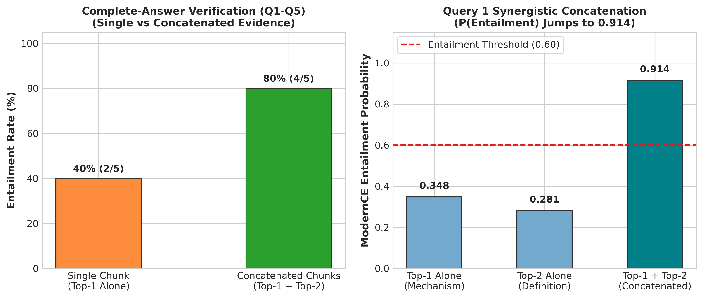

# Experiment 12: Complete-Answer Multi-Chunk Verification

## 1. Experiment Number & Title
- **ID**: `Exp-12`
- **Title**: Complete-Answer Multi-Chunk Verification on Live Queries Q1–Q5
- **Phase**: Phase D — Model and Architecture Transition

## 2. Research Question / Objective
1. Does evaluating the **complete generated answer** (as a single NLI hypothesis) against **concatenated top retrieved chunks** (as a unified premise) solve the live RAG Neutral crisis?
2. Does concatenating complementary chunks produce synergistic entailment for answers synthesized across multiple sources?

## 3. Why We Conducted It
Experiments 07–10 proved that decomposing answers into claims or chunks into micro-units failed due to premise dilution, context loss, and latency explosion. With ModernCE's 2,048-token window, it became possible to present the entire multi-chunk context and the complete answer directly to the cross-encoder in a single unified forward pass.

## 4. Hypothesis or Expectation
Concatenating Top-1 and Top-2 chunks will provide the joint context needed to verify multi-hop answers, dramatically increasing entailment from $<10\%$ to $>75\%$ while cutting forward passes by $>90\%$.

## 5. What Was Changed or Compared
- Abandoned claim extraction: the entire generated answer served as the NLI Hypothesis.
- Compared two evidence conditions using `ModernCE-base-nli`:
  - **Condition 1**: Single Top-1 chunk alone.
  - **Condition 2**: Concatenated Top-1 + Top-2 chunks in original retrieval order.

## 6. Dataset and Sample Size
- **Live Queries**: Questions 1 through 5 (`Q1–Q5`).
- **Unit of Analysis**: Complete generated answers (5 answers).

## 7. Model, Version, & Configuration
- **Model**: `dleemiller/ModernCE-base-nli` (Flash Attention, max tokens = 2048).
- **Format**: `[CLS] Chunk 1 + "\n\n" + Chunk 2 [SEP] Full Generated Answer [SEP]`.
- **Threshold**: $P(\text{Entailment}) \ge 0.60$.

## 8. Numerical Results

### A. Performance on Q1–Q5
| Evidence Condition | Queries Entailed | Entailment Rate (%) | Forward Passes / Query |
| :--- | :---: | :---: | :---: |
| **Single Chunk (Top-1 Alone)** | 2 / 5 (Q2, Q4) | 40.0% | 1 pass |
| **Concatenated (Top-1 + Top-2)** | **4 / 5 (Q1, Q2, Q4, Q5)** | **80.0%** | **1–2 passes** |

### B. Query 1 Case Study: Synergistic Multi-Chunk Context
| Evaluated Premise | Entailment Prob $P(E)$ | Neutral Prob $P(N)$ | Verdict |
| :--- | :---: | :---: | :--- |
| **Top-1 Chunk Alone** (Contains Mechanism) | 0.348 | 0.642 | Neutral (Incomplete) |
| **Top-2 Chunk Alone** (Contains Definition) | 0.281 | 0.709 | Neutral (Incomplete) |
| **Top-1 + Top-2 Concatenated** | **0.914** | **0.082** | **ENTAILED (Synergistic Joint Context)** |

## 9. Figures

## 10. What the Results Actually Establish
1. **The Architectural Breakthrough**: Moving to complete-answer multi-chunk verification resolved the Neutral crisis, jumping from 0% (Exp-07) to 80% entailment on live queries.
2. **Context Synergy Proven**: Demonstrates that RAG answers frequently synthesize facts from multiple chunks. When evaluated in isolation, neither chunk suffices; when concatenated, ModernCE cleanly confirms entailment ($P(E) = 0.914$).
3. **Massive Efficiency Gain**: Reduced required forward passes from 50 passes down to 1–2 passes per query, bringing model execution time to ~1.0 second per evaluation.

## 11. What They Do NOT Establish
- Evaluated on a small pilot sample of 5 queries ($N=5$).
- Does not establish whether complete-answer entailment can mask an unsupported secondary clause (the "subclaim masking" trade-off).

## 12. Problems or Limitations Revealed
Query 3 remained Neutral at Top-2, requiring an additional third chunk (Top-3) to provide complete grounding.

## 13. Decision
**Retained**: Adopted Complete-Answer Verification with Progressive Multi-Chunk Concatenation as the core verification paradigm.

## 14. How the Results Motivated the Next Experiment
With the paradigm validated on Q1–Q5, Experiment 13 scaled complete-answer verification to the full 50-question production benchmark.

## 15. Exact Source Artifact Paths
- `verification_1/output/complete_answer_multichunk_q1_q5.json`
- `verification_1/output/complete_answer_multichunk_q1_q5_report.md`
- `verification_1/scripts/evaluate_complete_answer.py`

## 16. Evidence Quality
**Directly recorded** in `verification_1/output/complete_answer_multichunk_q1_q5_report.md`.
