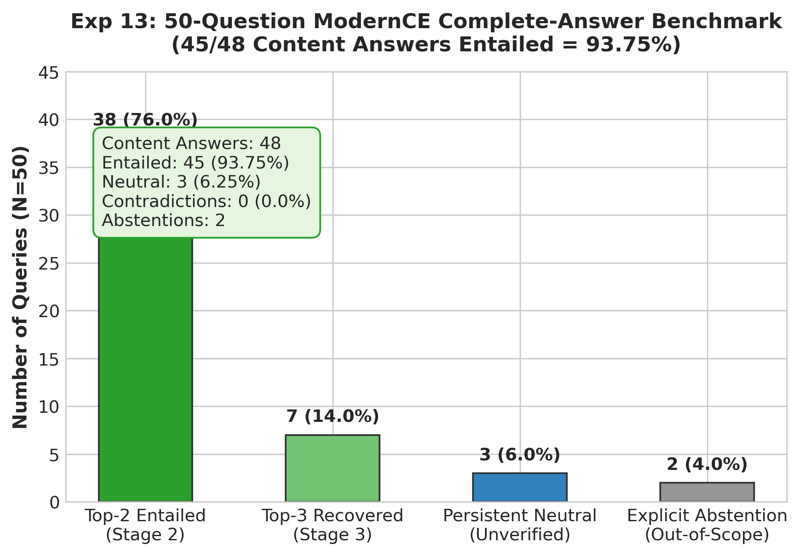

# Experiment 13: 50-Question ModernCE Complete-Answer Benchmark

## 1. Experiment Number & Title
- **ID**: `Exp-13`
- **Title**: 50-Question ModernCE Complete-Answer Benchmark
- **Phase**: Phase D — Model and Architecture Transition

## 2. Research Question / Objective
How effectively does the Complete-Answer Progressive Multi-Chunk Verifier ground generated responses across the entire 50-question production benchmark?

## 3. Why We Conducted It
This experiment represents the definitive project benchmark. Having established proof of concept on Q1–Q5 in Exp-12, this run quantified system-wide entailment rates, recovery rates at progressive stages, abstention handling, and failure modes across 50 diverse questions.

## 4. Hypothesis or Expectation
Progressive concatenation across Top-1, Top-2, and Top-3 chunks will ground $>90\%$ of substantive answers with zero false contradictions.

## 5. What Was Changed or Compared
Evaluated all 50 production queries (`data/queries.json`) using progressive multi-chunk verification:
- **Stage 1**: Top-1 chunk.
- **Stage 2**: Concatenated Top-1 + Top-2 chunks (evaluated if Stage 1 is not entailed).
- **Stage 3**: Concatenated Top-1 + Top-2 + Top-3 chunks (evaluated if Stage 2 is not entailed).

## 6. Dataset and Sample Size
- **Dataset**: `data/queries.json` (50 production queries).
- **Substantive Content Answers**: 48 queries.
- **Explicit Abstentions**: 2 queries (Q2 and Q48 were out-of-scope queries where the RAG model correctly stated that the textbook did not contain the requested information).
- **Total Evaluations**: 312 ModernCE forward passes across the benchmark.
- **Unit of Analysis**: Complete generated answers.

## 7. Model, Version, & Configuration
- **Model**: `dleemiller/ModernCE-base-nli` (PyTorch CPU execution).
- **Threshold**: $P(\text{Entailment}) \ge 0.60$.
- **Sequence Budget**: 2,048 max tokens.

## 8. Numerical Results

### A. Core Verification Outcomes (N=48 Content Answers)
| Verification Outcome | Query Count | Rate vs Content Answers (N=48) | Rate vs Total Benchmark (N=50) |
| :--- | :---: | :---: | :---: |
| **Total Entailed Answers** | **45** | **93.75%** | **90.0%** |
| — Entailed at Top-2 Stage | 38 | 79.17% | 76.0% |
| — Entailed at Top-3 Stage (Recovered) | 7 | 14.58% | 14.0% |
| **Persistent Neutral (Unverified)** | **3** | **6.25%** (Q11, Q31, Q36) | 6.0% |
| **Contradictions Detected** | **0** | **0.0%** | 0.0% |
| **Explicit Abstentions (Out-of-Scope)** | **2** | — (Q2, Q48) | 4.0% |

### B. Execution Latency
| Metric | Measured Result |
| :--- | :---: |
| **Average Verifier Latency per Query** | **8.33 s** (CPU) |
| **Total NLI Forward Passes** | 312 passes (Avg ~6.2 passes / query across stages) |
| **Stage 1 Stopping Latency** | ~1.2 s |
| **Stage 2 Stopping Latency** | ~2.3 s |
| **Stage 3 Stopping Latency** | ~3.8 s |

## 9. Figures

## 10. What the Results Actually Establish
1. **High Entailment Rate**: 45 out of 48 substantive content answers (**93.75%**) are formally entailed by the retrieved textbook chunks under ModernCE.
2. **Top-3 Progressive Recovery**: 7 queries that were Neutral at Top-2 were successfully grounded and entailed when Top-3 was added, proving the value of progressive multi-chunk concatenation.
3. **Zero False Contradictions**: The verifier produced 0 contradictions across 50 questions.

## 11. What They Do NOT Establish
- **93.75% Entailment is NOT 93.75% Independent Factual Accuracy**: Entailment measures model-judged logical derivation from retrieved chunks; it does not constitute independent human factual verification.
- Complete-answer verification evaluates holistic entailment and can occasionally mask an unsupported secondary clause if the core proposition dominates.

## 12. Problems or Limitations Revealed
1. **Three Persistent Neutrals (Q11, Q31, Q36)**: Chunks contained relevant topical discussion but omitted specific fine-grained numerical details synthesized in the answer.
2. **Abstention Inefficiency**: In this standalone experiment, the two out-of-scope abstentions (Q2, Q48) were routed through all 3 NLI stages, wasting 14 forward passes on answers that already admitted non-retrieval.

## 13. Decision
**Core Benchmark Established**: Validated the architecture. Prompted Experiment 14 to build production parity and an automated abstention bypass.

## 14. How the Results Motivated the Next Experiment
Experiment 14 integrated this logic into `verification_1/verifier.py` with an automated regex filter (`is_abstention_answer`) to bypass NLI inference on out-of-scope responses.

## 15. Exact Source Artifact Paths
- `verification_1/output/modernce_50q_complete_answer/experiment_report.md`
- `verification_1/output/modernce_50q_complete_answer/results.json`
- `verification_1/output/modernce_50q_complete_answer/evaluation_summary.json`
- `verification_1/output/modernce_50q_complete_answer/per_question/` (Q1.json to Q50.json)

## 16. Evidence Quality
**Directly recorded** in `verification_1/output/modernce_50q_complete_answer/results.json`.
