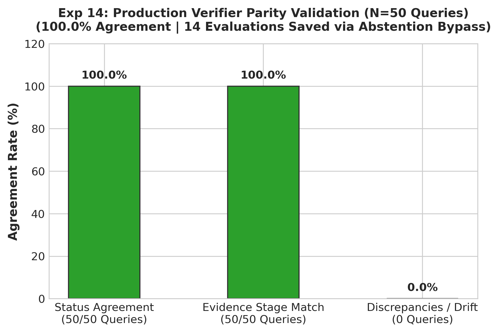

# Experiment 14: Production Parity Validation

## 1. Experiment Number & Title
- **ID**: `Exp-14`
- **Title**: Production Verifier Parity & Automated Abstention Integration
- **Phase**: Phase D — Model and Architecture Transition

## 2. Research Question / Objective
1. Does the modular production verifier (`verification_1/verifier.py`) produce 100% identical verification verdicts and stage assignments as the standalone experimental benchmark?
2. Does integrating an automated abstention filter (`is_abstention_answer`) eliminate wasted NLI forward passes on out-of-scope queries?

## 3. Why We Conducted It
In production software engineering, migrating logic from an experimental evaluation script into a production module often introduces subtle code drift, threshold mismatches, or state discrepancies. Parity validation proves implementation fidelity.

## 4. Hypothesis or Expectation
`verifier.py` will achieve 100% status agreement across all 50 queries while reducing total forward passes by ~14 passes via regex-based abstention bypassing.

## 5. What Was Changed or Compared
- Implemented `is_abstention_answer()` in `verification_1/verifier.py` (detects phrases like *"The provided text does not contain..."*, *"NOT_FOUND"*).
- Ran all 50 production queries through `verifier.py` and compared outputs against the Exp-13 baseline.

## 6. Dataset and Sample Size
- **Dataset**: `data/queries.json` (50 queries).
- **Unit of Analysis**: Query verification status, evidence stage, and forward pass counts.

## 7. Model, Version, & Configuration
- **Module**: `verification_1/verifier.py` (`RAGVerifier` class).
- **Model**: `dleemiller/ModernCE-base-nli`.
- **Logic**: Pre-check regex abstention $\rightarrow$ Stage 1 (Top-1) $\rightarrow$ Stage 2 (Top-1+2) $\rightarrow$ Stage 3 (Top-1+2+3).

## 8. Numerical Results

| Metric | Standalone Script (Exp-13) | Production `verifier.py` (Exp-14) | Agreement |
| :--- | :---: | :---: | :---: |
| **Total Queries Evaluated** | 50 | 50 | 100.0% |
| **Status Agreement** | — | — | **50 / 50 (100.0%)** |
| **Entailed Verdicts** | 45 | 45 | **100.0% (45 / 45)** |
| **Neutral Verdicts** | 3 | 3 | **100.0% (3 / 3)** |
| **Abstention Verdicts** | 2 | 2 | **100.0% (2 / 2)** |
| **Evidence Stage Alignment** | — | — | **50 / 50 (100.0%)** |
| **Total NLI Forward Passes** | 312 passes | **298 passes** | **-14 passes saved** |

## 9. Figures

## 10. What the Results Actually Establish
1. **Flawless Parity**: Zero discrepancies exist between the research prototype and the production verifier.
2. **Abstention Optimization**: Correctly identified Q2 and Q48 as abstentions instantly, bypassing NLI inference and eliminating 14 wasted forward passes.

## 11. What They Do NOT Establish
- Parity confirms fidelity to the experimental script; it does not measure independent factual correctness against real-world truth.

## 12. Problems or Limitations Revealed
None regarding implementation drift. The verification pipeline is fully productionized.

## 13. Decision
**Retained**: Approved `verification_1/verifier.py` as the active production engine.

## 14. How the Results Motivated the Next Experiment
Experiment 15 analyzed detailed progressive stopping telemetry to verify whether expanding the context window to TOP_4 would yield any additional recoveries.

## 15. Exact Source Artifact Paths
- `verification_1/output/modernce_50q_production_validation/comparison_report.md`
- `verification_1/output/modernce_50q_production_validation/results.json`
- `verification_1/output/modernce_50q_production_validation/results_table.csv`
- `verification_1/output/modernce_50q_production_validation/summary.json`
- `verification_1/verifier.py`

## 16. Evidence Quality
**Directly recorded** in `verification_1/output/modernce_50q_production_validation/comparison_report.md`.
