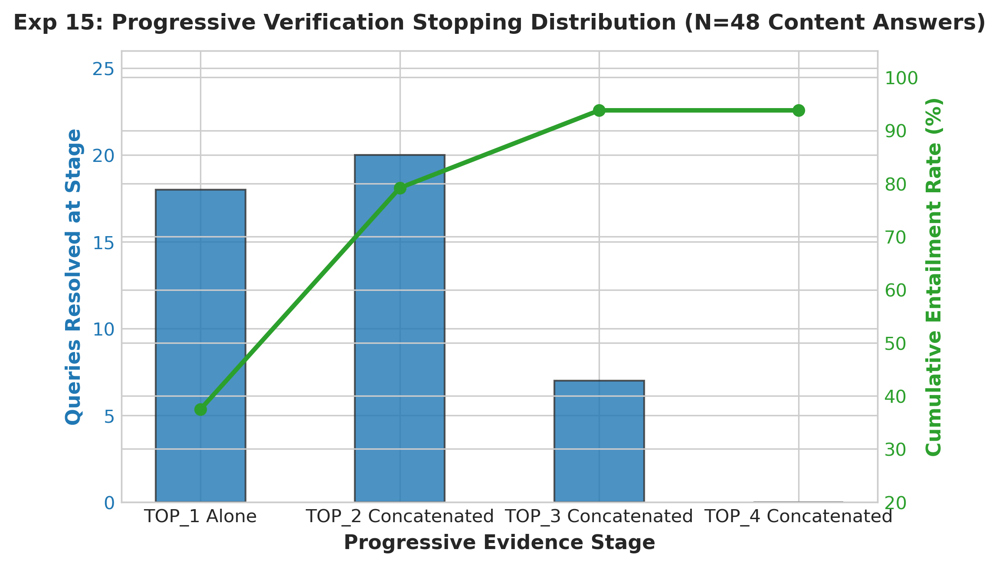

# Experiment 15: Progressive Verification Stage Telemetry

## 1. Experiment Number & Title
- **ID**: `Exp-15`
- **Title**: Progressive Multi-Chunk Stopping Distribution & Latency Telemetry
- **Phase**: Phase D — Model and Architecture Transition

## 2. Research Question / Objective
1. At what progressive evidence stage (TOP_1, TOP_2, TOP_3, or TOP_4) are queries successfully grounded and resolved?
2. Does concatenating a fourth chunk (TOP_4) recover any of the remaining persistent Neutral answers, or does it produce diminishing returns?

## 3. Why We Conducted It
Concatenating chunks increases token sequence length and inference latency. We needed telemetry to identify the exact point of diminishing returns to cap the progressive loop in production.

## 4. Hypothesis or Expectation
Top-2 and Top-3 will resolve $>90\%$ of queries, while Top-4 will add latency without recovering any of the 3 persistent Neutral queries.

## 5. What Was Changed or Compared
Evaluated the progression across four evidence stages for the 48 substantive content queries:
- **TOP_1**: Single chunk (~400 words)
- **TOP_2**: 2 chunks concatenated (~800 words)
- **TOP_3**: 3 chunks concatenated (~1,200 words)
- **TOP_4**: 4 chunks concatenated (~1,600 words)

## 6. Dataset and Sample Size
- **Sample**: 48 substantive content queries from `data/queries.json`.
- **Unit of Analysis**: Verification stage transitions and stopping counts.

## 7. Model, Version, & Configuration
- **Model**: `dleemiller/ModernCE-base-nli`.
- **Early-Stopping Criterion**: Exit immediately when $P(\text{Entailment}) \ge 0.60$.

## 8. Numerical Results

| Progressive Stage | Context Composition | Queries Resolved at Stage | Cumulative Entailed | Cumulative Rate (%) | Residual Neutrals | Stage Latency |
| :--- | :--- | :---: | :---: | :---: | :---: | :---: |
| **TOP_1** | Top-1 chunk alone | 18 | 18 | 37.50% | 30 | ~1.2 s |
| **TOP_2** | Top-1 + Top-2 concatenated | 20 | 38 | 79.17% | 10 | ~2.3 s |
| **TOP_3** | Top-1 + Top-2 + Top-3 | 7 | **45** | **93.75%** | **3** | ~3.8 s |
| **TOP_4** | Top-1 through Top-4 | **0** | **45** | **93.75%** | **3** | ~5.4 s |

## 9. Figures

## 10. What the Results Actually Establish
1. **Optimal Stopping at TOP_3**: 79.2% of queries resolve by TOP_2, and an additional 14.6% (7 queries) resolve at TOP_3, achieving 93.75% cumulative entailment.
2. **Zero Return at TOP_4**: TOP_4 failed to ground any of the 3 residual Neutral queries (Q11, Q31, Q36), while increasing latency by +1.6s and pushing input tokens near 1,600.

## 11. What They Do NOT Establish
- Does not test alternative re-ranking orderings (chunks were concatenated strictly in original hybrid retrieval order).

## 12. Problems or Limitations Revealed
Evaluating TOP_4 is wasteful; stopping at TOP_3 is the optimal performance-to-cost trade-off.

## 13. Decision
**Retained TOP_3 Cap**: Set the maximum progressive verification depth in `verifier.py` to TOP_3.

## 14. How the Results Motivated the Next Experiment
Experiment 16 investigated whether verification entailment scores on fixed retrieval outputs are statistically stable across repeated runs.

## 15. Exact Source Artifact Paths
- `verification_1/output/modernce_50q_complete_answer/results.json`
- `verification_1/output/diagnostic_timing_log.jsonl`
- `verification_1/output/telemetry_summary.md`

## 16. Evidence Quality
**Directly recorded** in `verification_1/output/modernce_50q_complete_answer/results.json`.
