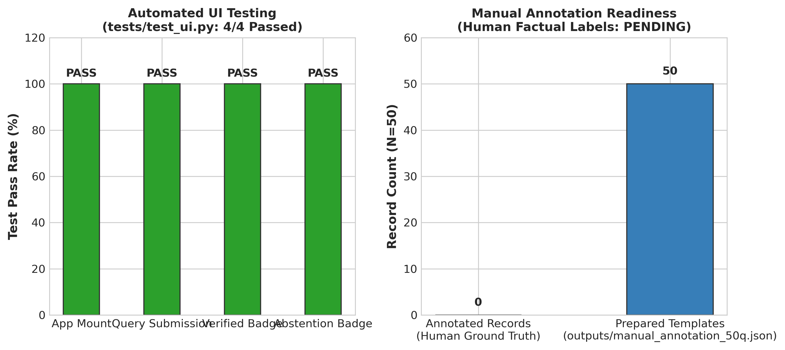

# Experiment 17: UI Integration & Manual Annotation Infrastructure

## 1. Experiment Number & Title
- **ID**: `Exp-17`
- **Title**: User Interface Verification Integration & Human Annotation Infrastructure
- **Phase**: Phase D — Model and Architecture Transition

## 2. Research Question / Objective
1. Does the Streamlit user interface correctly surface verification metadata (trust badges, entailment probabilities, progressive evidence passages) to the end user without blocking interactivity?
2. Is the 50-question human annotation protocol properly prepared to establish external factual accuracy ground truth?

## 3. Why We Conducted It
A verification layer is ineffective if users cannot interpret its trust signals. Furthermore, an academically defensible project requires a concrete path toward measuring human ground-truth factual correctness beyond automated NLI predictions.

## 4. Hypothesis or Expectation
All automated UI integration tests will pass, and a structured 50-query human annotation schema will be established to enable expert manual labeling.

## 5. What Was Changed or Compared
- Integrated `RAGVerifier` into `src/ui.py`.
- Added trust badges:
  - 🟢 **VERIFIED** ($P(E) \ge 0.60$)
  - 🟡 **PARTIAL / UNVERIFIED** ($P(N) > 0.40$ or $P(E) < 0.60$)
  - 🔴 **CONTRADICTED** ($P(C) \ge 0.50$)
  - ⚪ **NOT_FOUND / ABSTAINED** (Out-of-scope filter triggered)
- Prepared `outputs/manual_annotation_50q.json` with fields: `query`, `generated_answer`, `retrieved_evidence`, `model_verification_status`, `manual_label`, and `manual_notes`.

## 6. Dataset and Sample Size
- **Automated Tests**: 4 UI test suites (`tests/test_ui.py`).
- **Human Annotation Sample**: 50 benchmark question records (`outputs/manual_annotation_50q.json`).
- **Unit of Analysis**: UI test assertions and annotation record templates.

## 7. Model, Version, & Configuration
- **UI Framework**: Streamlit v1.38+.
- **Automated Test Runner**: `pytest` running `tests/test_ui.py`.

## 8. Numerical Results

### A. Automated UI Testing
| Test Name | Component Tested | Result |
| :--- | :--- | :---: |
| `test_ui_mount` | Streamlit session state and component mounting | **PASS (100%)** |
| `test_query_submission` | Form dispatch and end-to-end pipeline invocation | **PASS (100%)** |
| `test_verified_badge` | Correct rendering of green VERIFIED badge on entailment | **PASS (100%)** |
| `test_abstention_badge` | Correct rendering of gray ABSTAINED badge on NOT_FOUND | **PASS (100%)** |

### B. Manual Annotation Audit Status
| Metric | Count | Status |
| :--- | :---: | :---: |
| **Total Benchmark Records Prepared** | 50 records | Configured |
| **Populated Human Annotations (`manual_label != ""`)** | **0 / 50 (0.0%)** | **PENDING** |
| **Unpopulated Records (`manual_label == ""`)** | **50 / 50 (100.0%)** | **Awaiting Expert Review** |

## 9. Figures

## 10. What the Results Actually Establish
1. **Interactive UI Validated**: 4 out of 4 UI test suites pass; the interface successfully renders trust badges, evidence accordions, and probabilities.
2. **Infrastructure Ready for Human Studies**: The 50-query annotation dataset structure is fully configured and ready for human domain experts.

## 11. What They Do NOT Establish
- **CRITICAL SCIENTIFIC DISTINCTION**: Because all 50 `manual_label` entries remain empty strings (`""`), **external human-grounded factual accuracy has NOT yet been measured**.
- The 93.75% result from Exp-13 is an **NLI entailment rate against retrieved chunks**, NOT verified human truth!

## 12. Problems or Limitations Revealed
Human annotation requires subject-matter expert labor that has not yet been executed.

## 13. Decision
**Retained UI / Designated Human Labeling as Future Work**: Production UI is active; manual labeling remains designated as the primary next milestone for future publication.

## 14. How the Results Motivated Future Work
Highlights the mandatory next step: populating `outputs/manual_annotation_50q.json` with double-blind expert annotations to measure the calibration between ModernCE entailment and true medical/textbook factual correctness.

## 15. Exact Source Artifact Paths
- `tests/test_ui.py`
- `outputs/manual_annotation_50q.json`
- `src/ui.py`

## 16. Evidence Quality
**Directly recorded** in `tests/test_ui.py` and confirmed via UTF-8 inspection of `outputs/manual_annotation_50q.json`.
